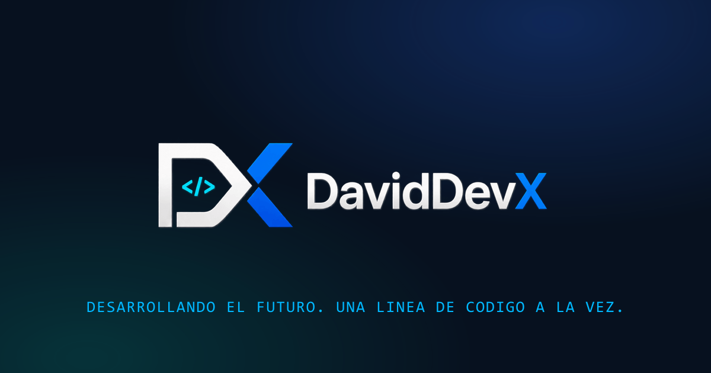

<div align="center">
  

  # Portafolio profesional de David Castillo

  Un portafolio web estático, responsive y accesible para presentar mi perfil, tecnologías y proyectos como desarrollador web.

  [Ver portafolio](https://portafoliodaviddevx.netlify.app/) · [GitHub](https://github.com/DavidDevXPe) · [Contacto](mailto:hectordavidcastillobailon@gmail.com)
</div>



## Sobre el proyecto

Este sitio reúne mi trayectoria desde Ingeniería de Industrias Alimentarias hacia el desarrollo web. La interfaz utiliza la identidad visual DavidDevX y presenta proyectos reales mediante demos, repositorios y casos de estudio breves.

El portafolio está construido sin frameworks ni dependencias en producción. La URL oficial de referencia es `https://portafoliodaviddevx.netlify.app/`; la conexión entre Netlify y este repositorio se gestiona fuera del código y debe verificarse en la configuración del servicio.

## Características

- Diseño responsive para escritorio, tablet y móvil.
- Navegación accesible con teclado y estados de foco visibles.
- Casos de estudio dentro de diálogos nativos.
- Imágenes WebP y recursos SVG optimizados.
- Metadatos Open Graph, Twitter Cards y datos estructurados Schema.org.
- Sitemap, reglas para buscadores y página 404 personalizada.
- Animaciones respetuosas con `prefers-reduced-motion`.
- Validación local sin dependencias externas.

## Tecnologías

- HTML5
- CSS3
- JavaScript
- Git y GitHub como repositorio
- Node.js únicamente para las herramientas locales de desarrollo

## Proyectos destacados

| Proyecto | Descripción | Demo | Código |
| --- | --- | --- | --- |
| Pokédex App | Onboarding de entrenador, búsqueda, filtros, favoritos y detalles con PokeAPI. | [Abrir](https://pokedex08.netlify.app/) | [Repositorio](https://github.com/DavidDevXPe/pokedex_app) |
| Rick and Morty App | Exploración de personajes, episodios y ubicaciones mediante la API de Rick and Morty. | [Abrir](https://rickandmorty99.netlify.app/) | [Repositorio](https://github.com/DavidDevXPe/Rick-and-Morty---App) |
| ATMOS \| App del Clima | Clima por ciudad o geolocalización con React y una API Express segura desplegada mediante Netlify Functions. | [Abrir](https://atmos-clima.netlify.app/) | [Repositorio](https://github.com/DavidDevXPe/App-Clima) |

## Estructura

```text
.
├── css/
│   └── styles.css
├── images/
├── js/
│   └── main.js
├── scripts/
│   ├── serve.mjs
│   └── validate-project.mjs
├── 404.html
├── index.html
├── robots.txt
└── sitemap.xml
```

## Desarrollo local

Se requiere Node.js 18 o superior. No es necesario instalar paquetes.

```bash
npm run dev
```

Después visita `http://127.0.0.1:4173`.

## Comprobaciones antes de publicar

```bash
npm run check
```

El comando comprueba la sintaxis de JavaScript, datos estructurados, URL canónica, sitemap, referencias locales, demos oficiales, hosts de despliegue obsoletos, IDs duplicados y estructura básica del CSS.

## Despliegue

La URL oficial del sitio es `https://portafoliodaviddevx.netlify.app/`. Este repositorio no contiene configuración suficiente para confirmar qué sitio de Netlify está conectado a la rama `main`; esa relación debe verificarse en Netlify. Los cambios aprobados se versionan con:

```bash
git add .
git commit -m "Descripción del cambio"
git push
```

## Autor

**David Castillo — DavidDevX**

- GitHub: [@DavidDevXPe](https://github.com/DavidDevXPe)
- Correo: [hectordavidcastillobailon@gmail.com](mailto:hectordavidcastillobailon@gmail.com)
- Estado: disponible para empleo y proyectos freelance
